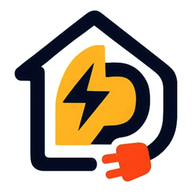

  

<h1 align="center">DC Elétrica Residencial</h1>

  Site oficial da DC Elétrica Residencial, eletricista em Pederneiras-SP e região. 
  <a href="https://dceletric.com.br"><strong>dceletric.com.br</strong></a>

<strong>Versão 1.2</strong>

---

## Sobre o projeto

Este é o site institucional da **DC Elétrica Residencial**, empresa de instalações e manutenção elétrica residencial que atende Pederneiras-SP e cidades vizinhas.

O site apresenta os serviços, mostra trabalhos realizados e leva o cliente direto ao WhatsApp para pedir orçamento. É uma página única, leve e feita para funcionar bem no celular.

**Acesse:** [https://dceletric.com.br](https://dceletric.com.br)

## Novidades da versão 1.2

- Novo layout para celular: o cliente chega ao orçamento muito mais rápido.
- Barra de navegação rápida fixa no topo (Serviços, Trabalhos e Contato), com destaque para a seção em que o cliente está.
- No computador, o menu do topo também mostra uma barrinha amarela na seção atual.
- Galeria de trabalhos em carrossel: basta deslizar para o lado, sem rolar a tela por várias fotos grandes.
- Textos, espaçamentos e cartões mais compactos no celular.
- Botão com o ícone do Instagram ao lado de "Ver trabalhos", na primeira tela do site.

## Novidades da versão 1.1

- Nova seção **Fale Conosco**, com formulário de contato (nome, telefone, bairro/cidade, assunto e mensagem).
- Ao enviar, a mensagem chega direto por e-mail para a empresa, e o cliente vê a confirmação na própria página.
- Botão extra "Enviar via WhatsApp" abre a conversa com a mensagem já preenchida, para um atendimento mais rápido.
- Canais diretos (WhatsApp, Instagram, área e horário de atendimento) e mapa de Pederneiras-SP.
- Link "Contato" do menu leva à nova seção com rolagem suave.
- Ícone do topo do site corrigido: agora usa a logo com fundo branco.
- Ícones do navegador e do celular atualizados com a logo em fundo branco.

## Serviços da empresa

- Quadros de distribuição (QDC), com disjuntores, DR e DPS
- Tomadas e interruptores
- Projetos de iluminação e LED
- Refletores e iluminação externa
- Padrão de entrada (CPFL / concessionária)
- Instalação de chuveiros
- Manutenção geral e correção de curtos-circuitos
- Infraestrutura e eletrodutos

## Sobre mim

Meu nome é **Gustavo Vicente Cardoso**, trabalho na DC Elétrica Residencial. Trabalho com elétrica residencial com foco em segurança, acabamento limpo e atendimento direto com o cliente. O lema da empresa é "Precisou, chamou!".

## Contato

- **Site:** [dceletric.com.br](https://dceletric.com.br)
- **WhatsApp:** (14) 92009-5531
- **Instagram:** [@dceletrica.residencial](https://www.instagram.com/dceletrica.residencial/)
- **Atendimento:** Pederneiras-SP e região

## Estrutura dos arquivos

| Arquivo | Descrição |
|---|---|
| `index.html` | Página do site |
| `favicon.ico` e `favicon-*.png` | Ícones da aba do navegador |
| `apple-touch-icon.png`, `icon-192.png`, `icon-512.png` | Ícones para celular e logo do site |
| `og-image.png` | Imagem de prévia ao compartilhar o link |
| `site.webmanifest`, `robots.txt`, `sitemap.xml` | Arquivos para navegadores e buscadores |

## Créditos e direitos

Criação, conteúdo, logo, fotos e marca: **Gustavo Vicente Cardoso**.

© 2026 Gustavo Vicente Cardoso, DC Elétrica Residencial. **Todos os direitos reservados.**

Este repositório é público apenas para visualização. Não é permitido copiar, modificar, redistribuir ou usar o código, as imagens, a logo ou o nome da marca, no todo ou em parte, sem autorização por escrito do autor. Para pedir autorização, entre em contato pelos canais acima.
